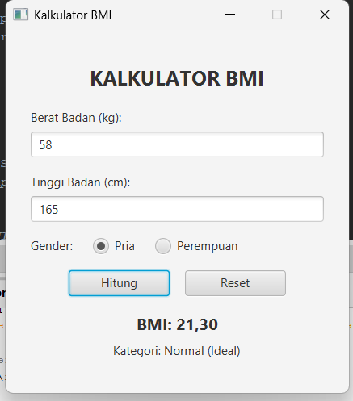
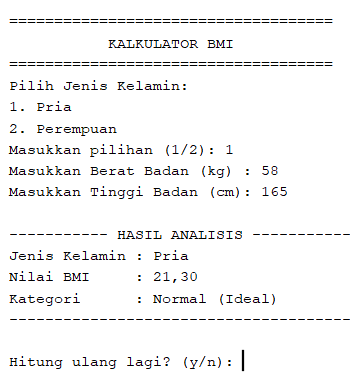

# Kalkulator BMI (JavaFX & CLI)

Aplikasi untuk menghitung **Body Mass Index (BMI)** berdasarkan berat badan, tinggi badan, dan jenis kelamin (Pria & Perempuan). Proyek ini dibangun menggunakan **Java** dan **Maven** dengan menerapkan konsep **Object-Oriented Programming (OOP)** (*Inheritance* & *Polymorphism*) serta arsitektur **Model-View-Controller (MVC)**.

---

## Tampilan Aplikasi (Screenshots)

| Antarmuka Grafis (JavaFX / Scene Builder) | Antarmuka Teks (Terminal / CLI) |
| :---: | :---: |
|  |  |


---

## Fitur Utama
- **Dual Interface**: Mendukung eksekusi melalui tampilan GUI (**JavaFX Scene Builder**) maupun interaktif via **Terminal (CLI)**[cite: 4, 6, 7].
- **Perhitungan Spesifik Gender**: Menerapkan *inheritance* dan *method overriding* pada class `BMI_Pria` dan `BMI_Perempuan` untuk menentukan kategori ideal sesuai standar masing-masing gender[cite: 1, 2, 4].
- **Validasi Input**: Dilengkapi penanganan *exception* untuk mencegah input kosong, angka negatif/nol, atau karakter non-numerik.

---

## Struktur Proyek
```text
kalkulator-BMI/
├── screenshots/
│   ├── UI-BMI.png                # Screenshot tampilan GUI JavaFX
│   └── BMI-Terminal.png          # Screenshot tampilan CLI Terminal
├── src/main/
│   ├── java/
│   │   ├── controller/
│   │   │   └── BMI_Controller.java
│   │   ├── main/
│   │   │   ├── Main.java
│   │   │   └── demoTerminal.java
│   │   └── model/
│   │       ├── BMI.java
│   │       ├── BMI_Pria.java
│   │       └── BMI_Perempuan.java
│   └── resources/
│       └── BMI_View.fxml
└── pom.xml
